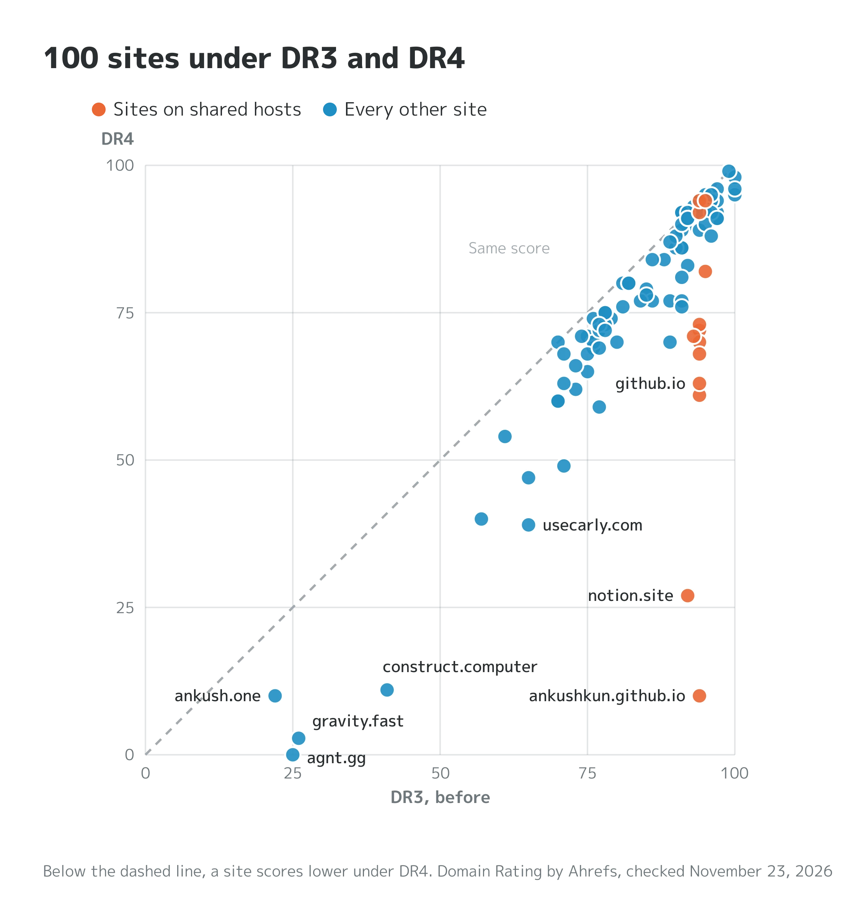
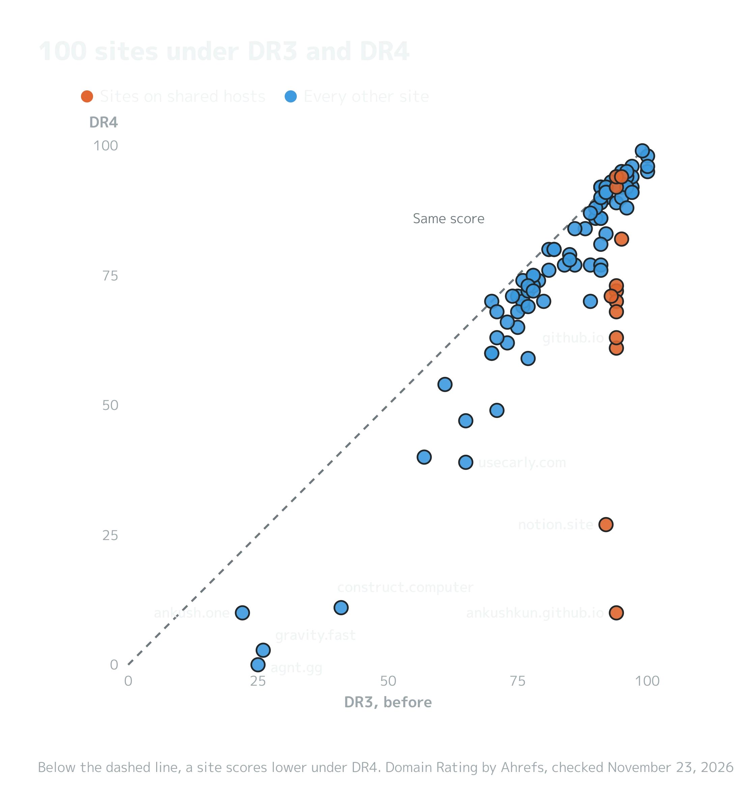
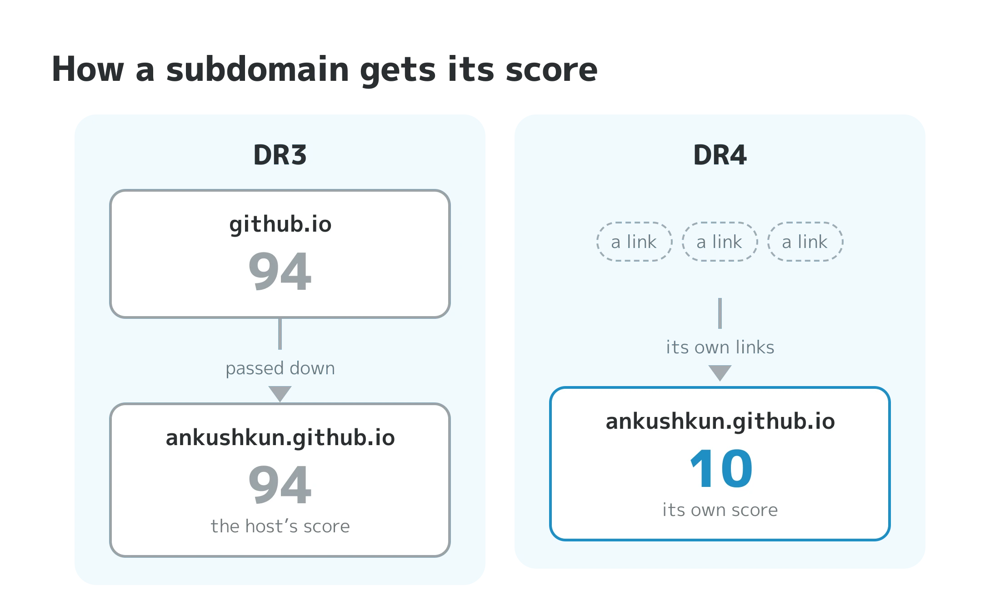
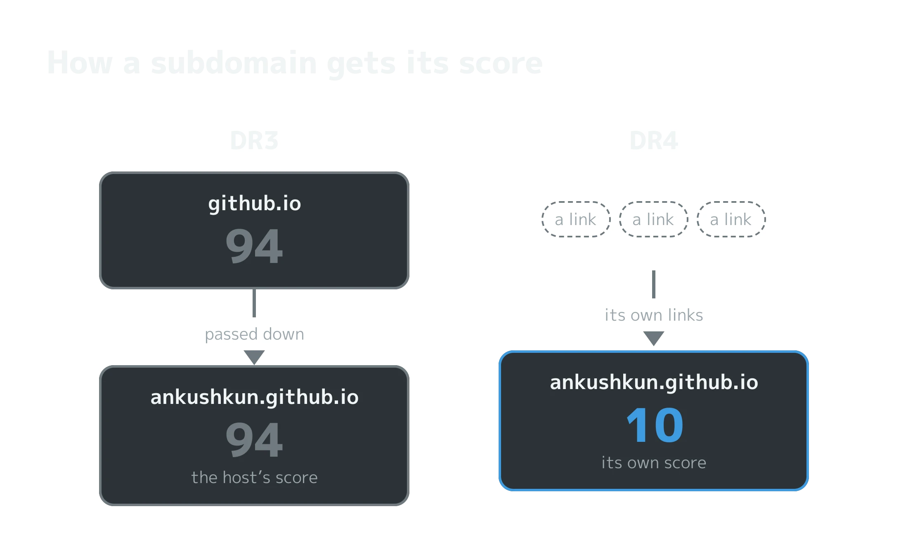
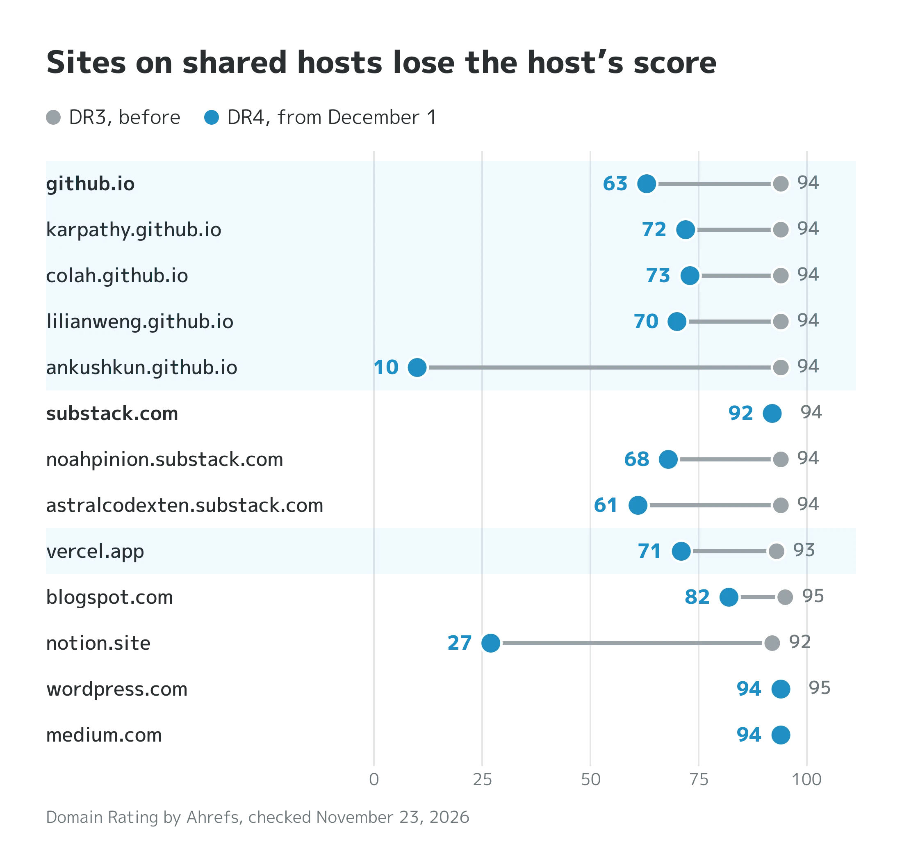
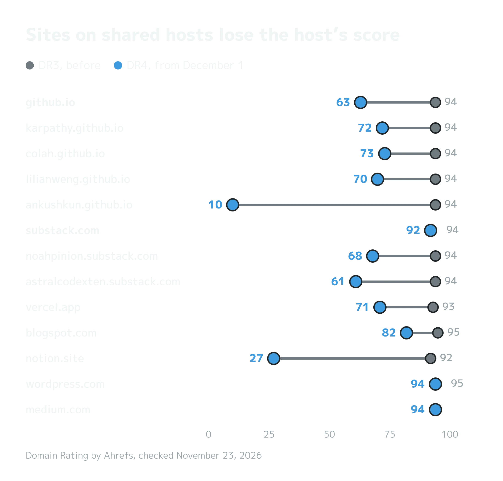

We recently shipped a free [domain authority checker](https://construct.computer/tools/domain-authority-checker/?utm_source=ankush.one&utm_medium=referral&utm_campaign=ahrefs-dr4) at Construct, my startup. It asks Ahrefs for a site's Domain Rating and puts it next to a few signals that are harder to fake. Then Ahrefs announced DR4, a new model for that score, and since the checker could already ask for both versions, the first thing I did was type in my own sites.

construct.computer went from 41 to 11. ankush.one went from 22 to 10. My old GitHub Pages site, ankushkun.github.io, went from 94 to 10.

That last one made me curious, so I ran 100 sites through both models on November 23. 88 of them score lower under DR4, 9 stay the same and 3 go up by a single point.

## What Ahrefs changed

Domain Rating is Ahrefs' 0 to 100 score for how strong a site's backlinks are. It still only looks at links, but [DR4](https://ahrefs.com/blog/domain-rating-dr4/) changes three things:

- links from sites that get search traffic count for more, so a link from a page nobody visits is worth less
- subdomains get scored on their own links instead of borrowing their host's score
- about half as many sites get a score at all

It becomes the number in the Ahrefs app on December 1, 2026. Until then you can get both versions from their free API, and Ahrefs says DR3 will only stick around there "for a short period of time" after the switch. If you report DR anywhere, write down both numbers this week.

## What happened to 100 sites

I picked the sites by hand in seven groups, so it's not a random sample, and it leans smaller than the internet's biggest sites. Ahrefs' own look at the 1,000 biggest sites found most of them went up. Mine mostly went down, and how far depended a lot on the kind of site:

| Group                    | Sites | Median change |
| :----------------------- | ----: | ------------: |
| Big platforms            |    10 |            -1 |
| SaaS and developer tools |    20 |          -2.5 |
| Personal sites           |    17 |            -5 |
| Subdomains of big sites  |    11 |            -5 |
| Launch directories       |    12 |          -5.5 |
| AI agent products        |    17 |            -6 |
| Sites on shared hosts    |    13 |           -22 |

The New York Times, YouTube, Reddit and Notion didn't move at all. The three that went up were ahrefs.com, moz.com and airtable.com, which I found a little funny given two of them sell SEO tools.

## My old GitHub Pages site was never a 94

Under DR3, every github.io site showed github.io's 94, so my old site looked as strong as Andrej Karpathy's blog. DR4 rates each one on its own links. karpathy.github.io lands at 72, colah.github.io at 73 and lilianweng.github.io at 70, which is still great for a single blog. Mine lands at 10, exactly where ankush.one sits, and honestly that's fair. Hardly anyone links to it.

The hosts themselves split in two. The ones that are mostly a home for other people's sites dropped hard: github.io went from 94 to 63, vercel.app from 93 to 71 and notion.site from 92 to 27. The ones that are big sites in their own right barely moved, like medium.com at 94 and substack.com going from 94 to 92.

If your blog lives on yourname.github.io, yourname.substack.com or blog.yourcompany.com, the number you used to see belonged to the host.

## Small and new sites pay for it

This is the group I care about most, since Construct is in it. All 17 AI agent products lost points. Zapier, Make, n8n and Cursor lost a few. The small ones lost a lot: usecarly.com fell from 65 to 39, agnt.gg from 25 to 0, and us from 41 to 11.

The part I didn't expect: those small sites are the ones AI engines kept citing in [our AI search audit](https://construct.computer/blog/ai-search-recommends-ai-employees/?utm_source=ankush.one&utm_medium=referral&utm_campaign=ahrefs-dr4). Grok cited usecarly.com in 41% of its answers about AI employees, and agnt.gg in 29%. A DR of 0 clearly didn't stop that, so if you care about showing up in AI answers, this number won't tell you much.

Developer tools split by age. Stripe, Vercel and Netlify lost 2 or 3 points, while Railway fell from 89 to 70, Resend from 91 to 77 and Clerk from 89 to 77. I can't see from DR which of their links stopped counting, but a younger company has had less time to collect links from sites people actually visit, and that's exactly what DR4 rewards.

Personal sites mostly lost a few points, and the ones that held up best are the ones Wikipedia cites most. martinfowler.com went from 89 to 87 and is linked from 131 English Wikipedia articles, paulgraham.com from 86 to 84 with 61, while leerob.com, with none, fell from 71 to 49. Wikipedia's own links are nofollow, so I don't think they're the reason. My guess is that a site Wikipedia editors keep citing is also cited everywhere else, by sites people actually read, and DR4 counts those links in full. It's also why the checker shows Wikipedia links, site age and a popularity rank next to DR. Anyone can buy links. Getting editors to cite you takes years.

Launch directories all went down too. Product Hunt barely moved, but uneed.best fell from 77 to 59 and microlaunch.net from 65 to 47. If you paid for a listing because of its DR, check it again before you renew. I've always cared more about [the places that send real people](/blogs/where-to-promote-product-hunt-launch/) anyway.

## What I'd do before December 1

1. Write down DR3 and DR4 for your site and the few sites you compare yourself against, while both still exist.
2. Rethink any DR cutoff you use, like "only pitch sites above DR 50". Sites between 50 and 79 in my sample lost a median of 7 points.
3. Check subdomains on their own, because your blog or docs now have a score of their own.

And don't panic about the drop. It compares two models, so a site that fell from 41 to 11 didn't lose a single link overnight. Its links are just being weighed differently.

## Check your own site

This is the same checker, live. Type in up to five sites and it shows DR4 next to DR3, plus each site's age, its Tranco rank, its Wikipedia links and whether it's flagged as unsafe.

<figure data-embed="https://construct.computer/tools/domain-authority-checker/embed/?domain=ankush.one,construct.computer,karpathy.github.io">
<a href="https://construct.computer/tools/domain-authority-checker/?domain=ankush.one,construct.computer,karpathy.github.io&utm_source=ankush.one&utm_medium=referral&utm_campaign=ahrefs-dr4">Open the domain authority checker</a>
</figure>

If you'd rather script it, add `&format=json` to the checker's address and you get the same answer as JSON. That's how I pulled all 100 sites.

The full write-up, with the method, every limit I know about and the table of all 100 sites, is [on the Construct blog](https://construct.computer/blog/ahrefs-dr4/?utm_source=ankush.one&utm_medium=referral&utm_campaign=ahrefs-dr4).
