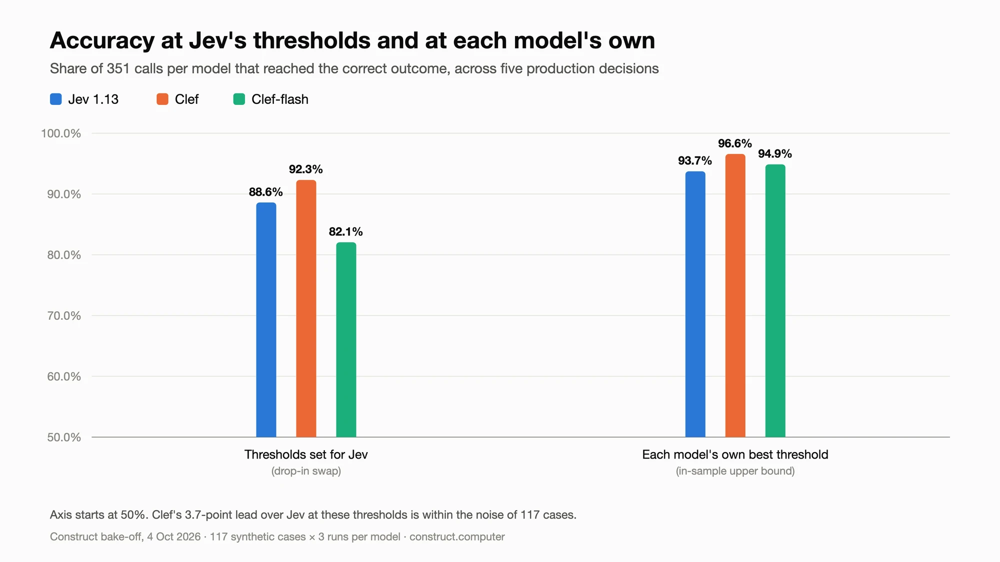
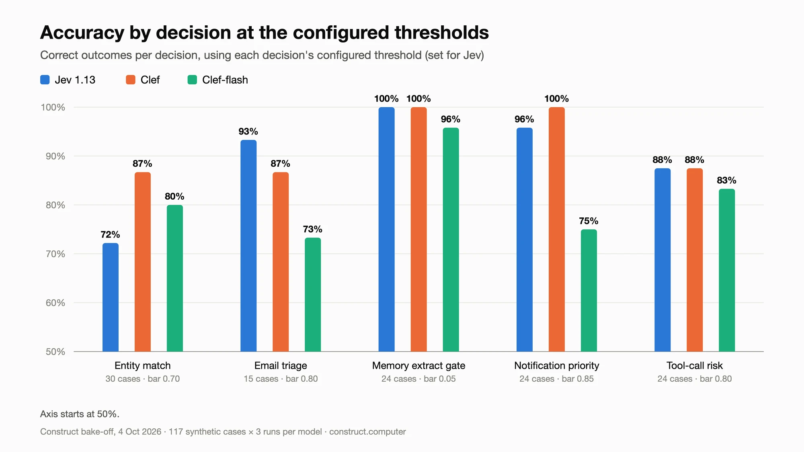
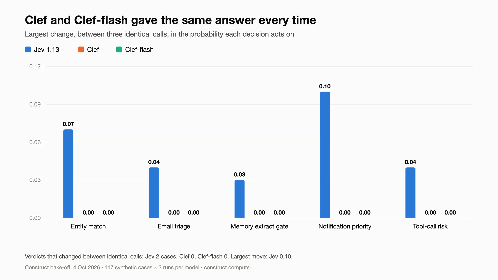
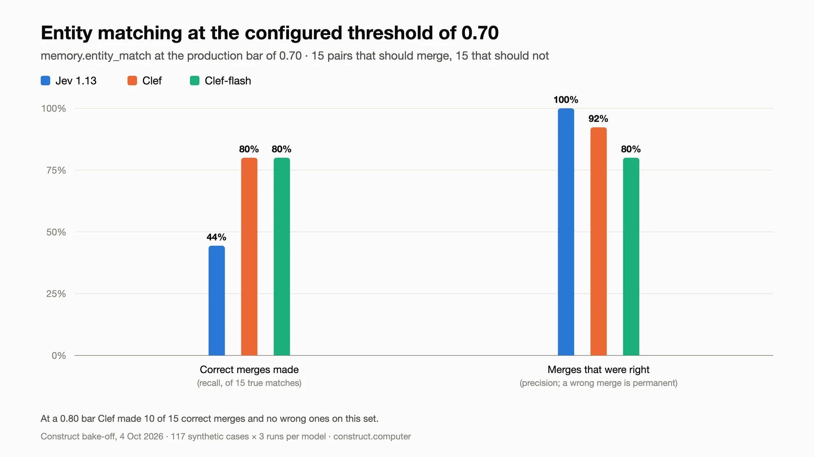
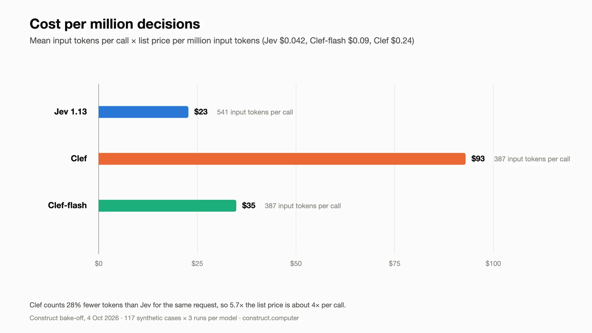

Clef is Cloudflare's open-weight decision model, made to accept the same requests as TypeSafe's Jev. On 117 labelled cases from five decisions an AI agent makes, Clef reached the right outcome on 92.3% of calls using thresholds set for Jev, against 88.6% for Jev and 82.1% for Clef-flash. Both Clef models returned the identical probability on every repeated call, and Jev did not.

> **Note, November 13, 2026.** Two facts have moved since October 4: Cloudflare now lists Clef-flash at $0.038 per million input tokens, down from $0.09, which puts it under Jev per decision on our requests (about $15 per million against $23), and Jev on Cloudflare now takes images in beta, with a versioned `typesafe/jev-1.14.0` route beside `typesafe/jev` ([Workers AI pricing](https://developers.cloudflare.com/workers-ai/platform/pricing/), [Jev 1.14.0 on Cloudflare](https://developers.cloudflare.com/ai/models/typesafe/jev-1.14.0/), both checked November 13, 2026).

We make Construct Computer. In October we had about 40 small agent decisions written for a decision model, every one of them written around Jev: the prompts, the questions and the thresholds. When Cloudflare released Clef on October 1, its launch post carried a table of ten public benchmarks, seven of them led by a Clef model, and one of the first replies on Hacker News was six words long: "Public benchmarks are easy to cheat" ([Traictory](https://traictory.com/news/2026-10-03-cloudflare-clef-decision-models), [Hacker News](https://news.ycombinator.com/item?id=49923692)). So we ran a test nobody could have trained for. We pointed our own requests, written for Jev, at Clef and Clef-flash without changing a line, and scored all three against labelled cases.

Every number below comes from our own runs on **October 4, 2026** (UTC): 117 cases, three calls each, three models, 1,053 calls in the main run, plus about 800 more in follow-up controls. Facts about the models come from Cloudflare's and TypeSafe's documentation, checked the same day.

|                                                          | Jev 1.13                                     | Clef    | Clef-flash |
| -------------------------------------------------------- | -------------------------------------------- | ------- | ---------- |
| Accuracy on thresholds set for Jev                       | 88.6%                                        | 92.3%   | 82.1%      |
| Accuracy on its own thresholds, chosen on held-out cases | 90.9%                                        | 93.2%   | 90.6%      |
| Repeated calls that returned the identical probability   | Moved by up to 0.10; 2 cases changed verdict | All 351 | All 351    |
| Cost per million decisions at October list prices        | $23                                          | $93     | $35        |

The gap between Clef and Jev is not statistically significant. Swapping models changed one string in our code, none of the 1,053 calls failed, and the main run cost about five cents.

## What are Clef and Clef-flash?

Clef and Clef-flash are decision models from Cloudflare: you send a state and a set of typed questions, and they return a probability for each allowed answer instead of generating text. Clef is a 27 billion parameter model built on Qwen3.8, and Clef-flash is a 9 billion parameter model built on Qwen3.5. Both are released under Apache 2.0 with weights on Hugging Face, both run on Workers AI, and both accept the same request format as Jev ([Cloudflare](https://blog.cloudflare.com/clef-decision-models/)).

Decision models make the fast, cheap judgment calls around a language model. Is this the same person? Does this email need a reply? Should this tool call wait for a human? TypeSafe calls the category System One models, after Kahneman's fast, intuitive System 1. Our [post on Jev and AI agents](https://construct.computer/blog/jev-ai-agents/?utm_source=ankush.one&utm_medium=referral&utm_campaign=crosspost) explains the idea.

Here is how the three compared on October 4, 2026, with the two cells that have changed since marked:

|                                | Jev 1.13                                   | Clef                  | Clef-flash                  |
| ------------------------------ | ------------------------------------------ | --------------------- | --------------------------- |
| Maker                          | TypeSafe AI                                | Cloudflare            | Cloudflare                  |
| Size                           | Not published                              | 27B parameters        | 9B parameters               |
| Weights                        | Closed                                     | Open, Apache 2.0      | Open, Apache 2.0            |
| Question types                 | Choice, Score, Noul                        | Same                  | Same                        |
| Input                          | Text and JSON (images in beta by November) | Text, JSON and images | Text, JSON and images       |
| Context                        | 64k tokens per request                     | 64k tokens            | 64k tokens                  |
| Price per million input tokens | $0.042                                     | $0.24                 | $0.09 ($0.038 by November)  |
| Output tokens                  | Free                                       | Free                  | Free                        |
| Workers AI model ID            | `typesafe/jev`                             | `@cf/cloudflare/clef` | `@cf/cloudflare/clef-flash` |

Two details in that table matter later. On October 4, Clef read images and Jev did not. And the prices are per input token, so the model that counts fewer tokens for the same request closes some of the gap.

## How we benchmarked Clef against Jev

We didn't write a new test for Clef. We took five decisions written for an agent and ran each one's request builder and interpreter unchanged.

| Decision              | What it decides                                                                 | Cases | Threshold set for Jev |
| --------------------- | ------------------------------------------------------------------------------- | ----- | --------------------- |
| Entity match          | Is this newly mentioned person, project or company one the agent already knows? | 30    | 0.70                  |
| Email triage          | Newsletter, receipt, spam, request, or keep?                                    | 15    | 0.80                  |
| Memory extract gate   | Does this conversation hold anything worth remembering?                         | 24    | 0.05                  |
| Notification priority | Does this automation notice deserve a toast, or can it wait?                    | 24    | 0.85                  |
| Tool-call risk        | Should this tool call wait for the user's go-ahead?                             | 24    | 0.80                  |

Entity match's threshold had been calibrated on Jev, as described below. The other four had been set by judgment with Jev in mind and had never been fitted to data, for Jev or anything else.

Swapping the model was the least interesting part of the work. This is the whole change:

```ts
// Before
await env.AI.run("typesafe/jev", { state, questions }, options);

// After
await env.AI.run("@cf/cloudflare/clef", { state, questions }, options);
```

Cloudflare says Clef is "fully Jev-API compatible". On our requests that held: Choice, Score and Noul questions, JSON state, and the response shape all worked unchanged, and all 702 Clef calls returned valid answers.

The 117 cases are all synthetic, weighted toward the edges of each decision. We drafted and labelled them with an AI assistant (Claude) before any of the three models saw them. No label came from Jev or Clef, and no second person has reviewed the labels.

Each case ran three times per model, one call at a time, with the models interleaved so they shared the same network conditions and the gateway cache skipped. A call counts as correct when the decision's interpreter reaches the labelled outcome at its configured threshold. We also report each model's best threshold, found on the same cases, which flatters all three equally.

The calls went through Cloudflare's REST API and our AI Gateway, from a laptop. That route is fine for accuracy and wrong for latency, which gets its own section.

## Clef vs Jev accuracy: the results



With no retuning at all, Clef had the highest score of the three, and the highest or equal-highest on four of the five decisions, on thresholds that were set for a different model.

Accuracy by decision at the configured threshold, with accuracy at each model's own best threshold in brackets:

| Decision              | Jev 1.13          | Clef              | Clef-flash    |
| --------------------- | ----------------- | ----------------- | ------------- |
| Entity match          | 72.2% (82.2%)     | **86.7%** (93.3%) | 80.0% (86.7%) |
| Email triage          | **93.3%** (93.3%) | 86.7% (93.3%)     | 73.3% (86.7%) |
| Memory extract gate   | **100%** (100%)   | **100%** (100%)   | 95.8% (100%)  |
| Notification priority | 95.8% (100%)      | **100%** (100%)   | 75.0% (100%)  |
| Tool-call risk        | **87.5%** (95.8%) | **87.5%** (95.8%) | 83.3% (100%)  |
| All five              | 88.6% (93.7%)     | **92.3%** (96.6%) | 82.1% (94.9%) |



The honest size of this result: Clef leads Jev by 3.7 points on 117 cases, with a 95% interval of -1.1 to +8.8 points. That is not statistically significant, and we wouldn't stretch it into "Clef beats Jev". Three of the entity cases are ones an agent can resolve in code before any model is asked (identical names, and names that differ only in case). Jev did worst on exactly those, and without them the lead shrinks to 2.0 points (92.1% against 90.1%). What we can say is narrower and more useful. Cloudflare's public numbers predicted Clef would be at least as good as Jev on decision tasks, and on private prompts it had never seen, written for its competitor, it was not measurably worse.

Jev deserves its due here too. It won email triage outright, it never made a wrong merge, and it was perfect on the extract gate. This is a close race between two good models.

## Is Clef deterministic?

Yes, on everything we sent it. We called each model three times with the same request for all 117 cases. Clef returned the same probability, to four decimal places, on all 351 calls, and so did Clef-flash. To rule out a cache, we sent the same requests again with changes that don't touch the model's input (a unique query string, reformatted JSON, reordered keys): same answers, a cache miss on every response, and a new inference ID each time.



The probability each Jev decision acts on moved between identical calls by up to 0.10, and two cases changed verdict from one call to the next. Across every probability Jev returned, the largest move was 0.16, and 100 of the 117 cases came back with at least one number different. TypeSafe describes Jev as returning "similar answers for similar inputs", which promises consistency rather than determinism, and a wobble of this size is consistent. But a decision layer acts when a probability crosses a line, so any wobble means a case near the line is decided by which call you happened to make.

Cloudflare's post explains why Clef behaves differently: the decision step is non-autoregressive, with choices derived directly from the model's internal representations and no text sampled along the way. We can confirm the practical result. For anyone who has debugged an agent that did something different the second time, this is the finding that matters most, more than a few points of accuracy.

## Jev's scores moved under the same version name

This one surprised us. On September 20 we calibrated our entity matcher on Jev. Real matches scored 0.71 to 0.82, everything else scored 0.34 or less, and we put the merge threshold at 0.70, in the gap.

Two weeks later we asked the same three calibration probes again.


All three now fell under the bar. To be sure this wasn't a noisy afternoon, we asked each probe 20 more times: none of the 60 calls reached 0.70, and the highest was 0.66. Clef, asked the same 20 times, returned the identical number every time. The served version was `jev-1.13.0` both times, so the alarm we had built to catch version changes stayed quiet. On this benchmark Jev still never merged two different people, which is the expensive mistake, but it made only 44% of the merges it should have. In an agent's memory, a missed merge becomes a duplicate.

We don't know why the scores moved. Our first suspect was our own route: we called Jev through Cloudflare's Workers AI, which couldn't pin a version. So we repeated everything against TypeSafe's own API with the version pinned to `jev-1.13.0`. Same result: none of 60 calls reached 0.70, and Jev's answers still varied between identical calls on 104 of 117 cases, so the route wasn't the cause. Three probes are still three probes, and our September baseline is one call each, so we aren't claiming Jev got worse in general. The lesson is about our own setup: a threshold is only as stable as the model under it, and a version string is no guarantee. Open weights can change that, if you use them, because a model you pin or host yourself can't move under its thresholds. The hosted Clef alias we tested carried no version either, so the same caution applies to it.

## Entity matching: where the three models differ most

Entity matching is the decision where a mistake is permanent. A wrong merge fuses two real people in the agent's memory, so precision matters more than recall. [AI agent memory](https://construct.computer/blog/ai-agent-memory/?utm_source=ankush.one&utm_medium=referral&utm_campaign=crosspost) covers what an agent's memory holds and how you correct it.



Clef caught the aliases this decision exists for: "Jose Garcia Marquez" against the accented spelling at 0.98, "Stripe, Inc." against "Stripe" at 0.98, "I.B.M." against "IBM" at 0.99. Its one wrong merge was "Acme" into a lone "Acme Corporation" at 0.78, a case reasonable people would argue about. At a 0.80 threshold, Clef made 10 of 15 correct merges and no wrong ones. That isn't a recommendation: it was picked on these same 30 cases, and "Acme" against "Acme Corporation" sits at 0.78, just under it.

Jev is no worse at telling people apart. Drop its threshold to 0.50 and it makes 64% of the correct merges, still with no wrong ones, close to Clef's 67% at 0.80. Its problem at 0.70 was that its scores moved, while its ranking of the pairs held.

Clef-flash is quick to say yes. It matched "Acme Labs Europe" to "Acme Labs" at 0.76 and the bare concept "pricing" to "pricing model" at 0.89, which is too eager for a merge and fine for a gate that only skips work. All three refused a one-letter surname typo, "Mendelsohn" against "Mendelson", which is right, since those can be two people.

## Thresholds do not transfer between decision models

If you take one thing from this post into your own migration, take this. A threshold is a property of a model and a prompt together. Move the model and the threshold is wrong, even when the new model is better.

The three models are not far apart in ability. Asked to rank our cases from "should act" to "should not", all three do it well: on the four decisions we could measure this way, the ranking score (AUROC) is 0.93 or higher for every model and a perfect 1.00 on two decisions. What differs is the number each model attaches to the same judgment.

The most accurate threshold per model on two decisions, against the configured one:

| Decision              | Configured | Jev's best | Clef's best | Clef-flash's best |
| --------------------- | ---------- | ---------- | ----------- | ----------------- |
| Tool-call risk        | 0.80       | 0.49       | 0.22        | 0.31              |
| Notification priority | 0.85       | 0.60       | 0.85        | 0.61              |

Clef-flash shows the effect best. On Jev's thresholds it scored 82.1%. With thresholds chosen for it on held-out cases it scored 90.6%, level with Jev's 90.9% on the same footing, and Clef stayed ahead at 93.2%. The 9B model was never bad at these decisions. It was being read with another model's ruler.

The thresholds in the table were found on the same cases they are scored on, which is why the bracketed figures in the results table (96.6%, 94.9%, 93.7%) run higher than the held-out ones. Treat them as a direction and not as settings. The practical rule is simple: swap the model in shadow, log probabilities for a week, and set the threshold from that.

## How fast is Clef? What we could and could not measure

Cloudflare reports a median of 209 ms for Clef and 38.8 ms for Clef-flash, against 524 ms for Jev. We can't confirm or dispute those numbers, because our harness was the wrong instrument.

We called all three models through Cloudflare's REST API from a laptop. The fastest call we saw for any model was 340 ms, and for every model the floor sat between 340 and 384 ms. That floor is the path: authentication, the public API, the gateway, and the round trip. You can't see a 38 ms model through a 340 ms window.

Latency per call through the REST API from a laptop, 351 calls per model (not a production measurement):

|                 | Jev 1.13 | Clef     | Clef-flash |
| --------------- | -------- | -------- | ---------- |
| Fastest call    | 384 ms   | 352 ms   | 340 ms     |
| Median          | 454 ms   | 654 ms   | 449 ms     |
| 95th percentile | 591 ms   | 1,262 ms | 1,024 ms   |

Those are the raw numbers. On this path Clef-flash matched Jev at the median, Clef was slower, and both Clef models had longer tails, three days after launch. None of that tells you what a Worker sees when it calls the model through the AI binding, next to the GPU. We haven't run that measurement.

## What does Clef cost compared with Jev?



Clef's list price is 5.7 times Jev's, which is the first thing the Hacker News thread did arithmetic on. Two things soften that.

First, Clef counted 28% fewer tokens than Jev for the same request: 387 per call against 541. Per decision, the gap is about 4 times, not 5.7.

Second, look at the unit. A million Clef decisions cost $93. All 1,053 calls in this benchmark cost about five cents. An agent that makes a thousand decisions a day spends about nine cents a day on Clef and two on Jev, next to a language model bill many times that. If you run billions of decisions a day, price it carefully, and look at Clef-flash, which cost $35 per million at its October price and about $15 at its November one. For everyone else, accuracy and repeatability are worth more than the difference.

## Clef vs Jev: which decision model should you use?

Based on our benchmark and each vendor's documentation, with prices as of November 13, 2026:

| If you need                                  | Pick                                | Why                                                                            |
| -------------------------------------------- | ----------------------------------- | ------------------------------------------------------------------------------ |
| The best accuracy without retuning           | Clef                                | Highest drop-in accuracy on our decisions, 92.3%                               |
| The same answer every time                   | Clef or Clef-flash                  | Identical probabilities on every repeated call                                 |
| To pin a version, self-host, or fine-tune    | Clef or Clef-flash                  | Open weights under Apache 2.0                                                  |
| To classify images                           | Clef or Clef-flash                  | Both have a vision encoder; Jev's image input is still in beta                 |
| The lowest price per decision                | Clef-flash                          | $0.038 per million input tokens, and fewer tokens counted per request than Jev |
| Zero wrong merges at your current thresholds | Jev                                 | 100% precision on entity matching, at the cost of recall                       |
| A high-volume gate that only skips work      | Clef-flash, with its own thresholds | 90.6% once retuned on held-out cases, at about a sixth of Clef's price         |
| Anything that merges, deletes or sends       | Clef, at a high threshold           | Clef-flash was too eager on lookalike names                                    |

Jev and Clef aren't the only decision models, and Cloudflare's launch table compares several others. We have only tested the three in this post.

## How to try Clef

- On Workers AI, call `@cf/cloudflare/clef` or `@cf/cloudflare/clef-flash` through the AI binding or the REST API. The request is a `state` plus a map of `questions`, the same as Jev.
- Coming from Jev, change the model ID and keep everything else. Then re-measure every threshold.
- To host it yourself, the weights are at `Cloudflare/clef` and `Cloudflare/clef-flash` on Hugging Face under Apache 2.0.
- Read the `probabilities` map and ignore the `confidence` field. It means different things on Clef and Jev, and on Jev it changed meaning between our September and October runs.
- Pace a REST benchmark. In October, Cloudflare's REST API throttled our token at roughly 90 calls a minute. The Workers binding is the route for real traffic.

A minimal request:

```bash
curl https://api.cloudflare.com/client/v4/accounts/$ACCOUNT_ID/ai/run \
  -H "Authorization: Bearer $API_TOKEN" \
  -d '{
    "model": "@cf/cloudflare/clef",
    "input": {
      "state": { "entity": { "type": "person", "name": "Dr. Priya Shah" } },
      "questions": {
        "match": {
          "type": "choice",
          "instructions": "Which candidate is the same entity?",
          "criteria": {
            "node-priya": "Priya Shah (person)",
            "none": "No candidate is clearly the same entity"
          }
        }
      }
    }
  }'
```

## What this benchmark does not show

- It is small: 117 cases, 15 to 30 per decision. A 3.7 point lead at that size is suggestive.
- It is synthetic. The cases are written to cover each decision's edges. Real traffic is mostly the easy middle, so real accuracy for all three models is probably higher.
- The labels are ours, drafted with an AI assistant, and no second person has checked them. A few are judgment calls, like whether "Acme" should merge into the only "Acme Corporation" in memory (we said no). Dropping the five most arguable ones doesn't change the order.
- Thresholds are tuned on small sets. The held-out figures are the fair ones, and they are still noisy at 15 to 30 cases per decision.
- Latency is unmeasured, as described above.
- It ran on one day, October 4, through Cloudflare, with Jev repeated on TypeSafe's own API. Clef was three days old, and Jev's scores had moved in two weeks. Either could look different now, which is the argument for running your own cases on a schedule.

Cloudflare published benchmarks, and people on the internet said benchmarks are easy to cheat. The fix for that is boring: write down your own cases, label them, and run every new model through them. Ours took an afternoon and a few cents, and it told us more about our own system than any leaderboard could. For why small, repeatable judgments matter so much in long tasks, read [your agent has a half-life](https://construct.computer/blog/agent-task-half-life/?utm_source=ankush.one&utm_medium=referral&utm_campaign=crosspost).
