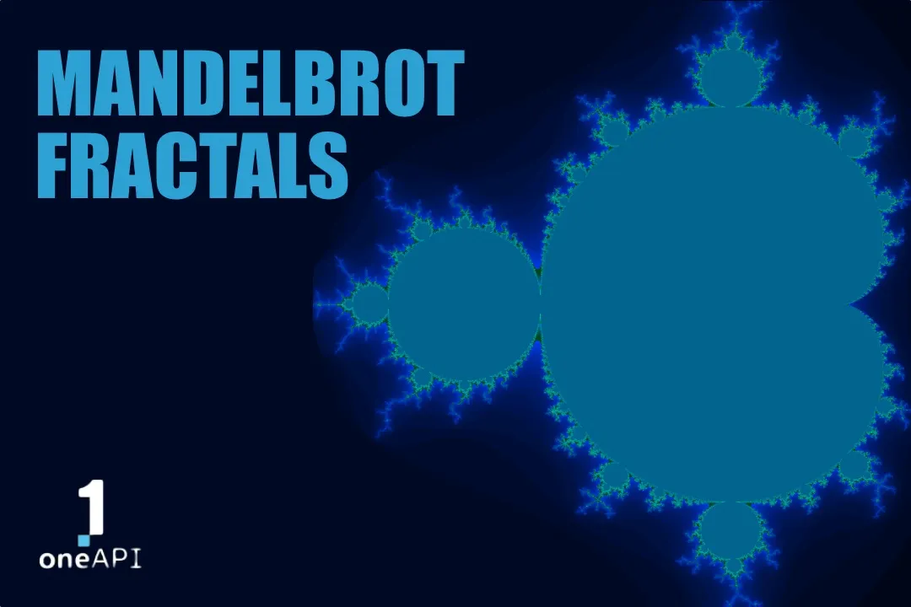
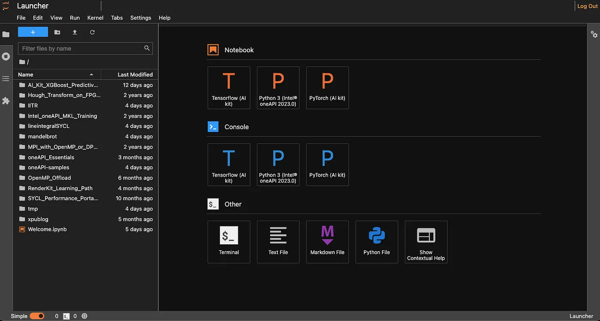
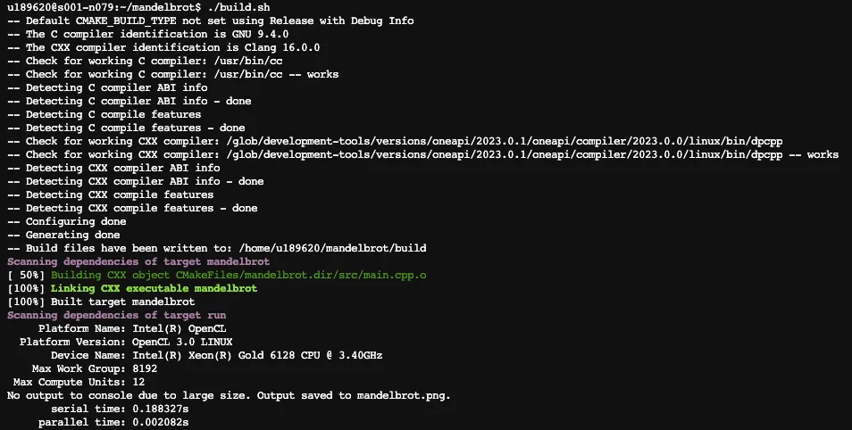
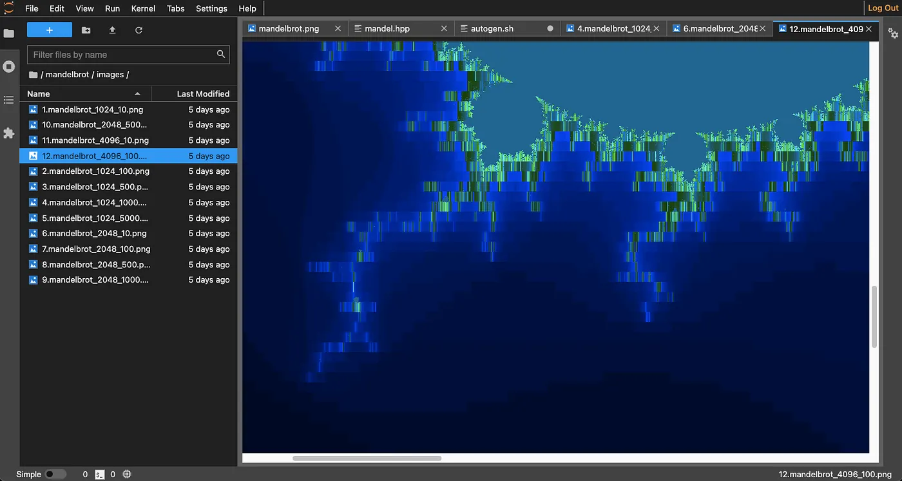

During Cognizance 2023 at IIT Roorkee, I attended a two-day Intel oneAPI workshop led by [Abhishek Nandy](https://medium.com/u/af7b551ddcdb) with my friend [Krish Agrawal](https://medium.com/@kragrrr), who co-authored this write-up. On day one we learned the SYCL programming model in JupyterLab; on day two we had a short hackathon to build something real with it.

## SYCL and the Mandelbrot set

**SYCL** (`/sɪkl/`) is an open Khronos Group standard for heterogeneous computing — you write standard C++ once and target CPUs, GPUs, or FPGAs without rewriting kernel code for each accelerator.



**Fractals** are geometric patterns that repeat across scales by iterating a simple mathematical rule. The **Mandelbrot set** is generated by repeatedly iterating a complex-number equation per pixel to see whether it stays bounded or escapes — an embarrassingly parallel workload that makes a great showcase for SYCL.

## Running the baseline on Intel DevCloud

Intel DevCloud provided a hosted sandbox with JupyterLab preconfigured for oneAPI so we could test SYCL workloads without installing the full local toolkit.

*(Note: [devcloud.intel.com/oneapi](https://web.archive.org/web/20241207195212/https://devcloud.intel.com/oneapi/) has since been retired, so the link points to an archived snapshot.)*



Inside the workspace, the starter `mandelbrot` directory compiles and renders a single fractal image:

```bash
cd mandelbrot
chmod +x build.sh
./build.sh
```



That compiled and rendered a `1024x1024` `mandelbrot.png` inside `build/` in **190 ms** (serial + parallel time) — noticeably faster than equivalent single-threaded C++ or Python. Opening `src/mandel.hpp` exposes four parameters controlling image size and detail: `row_size`, `col_size`, `max_iterations`, and `repetitions`.

## Automating sweeps with Bash

Rather than editing `src/mandel.hpp` by hand for every resolution and iteration count, we wrote `autogen.sh` to sweep across combinations of image sizes and pass counts automatically:

```bash
#!/bin/bash

PASSES=(10 100 500 1000 5000)
SIZES=(1024 2048 4096 8192 16384)

EDIT_FILE="src/mandel.hpp"
BUILD_FILE="build.sh"

prev_size=100
prev_pass=100
count=0

mkdir -p ./images

for SIZE in "${SIZES[@]}"; do
    for PASS in "${PASSES[@]}"; do
        echo ""
        echo "Generating fractal for ${SIZE}x${SIZE} with ${PASS} passes"
        echo ""

        sed -ie "s/row_size=$prev_size/row_size=$SIZE/g" "$EDIT_FILE"
        sed -ie "s/col_size=$prev_size/col_size=$SIZE/g" "$EDIT_FILE"
        sed -ie "s/max_iterations=$prev_pass/max_iterations=$PASS/g" "$EDIT_FILE"
        sed -ie "s/repetitions=$prev_pass/repetitions=$PASS/g" "$EDIT_FILE"

        prev_size=$SIZE
        prev_pass=$PASS
        count=$((count + 1))

        ./"$BUILD_FILE"

        echo ""
        echo "Generated ${SIZE}x${SIZE} with ${PASS} passes"
        echo ""

        cp "./build/mandelbrot.png" "./images/${count}.mandelbrot_${SIZE}_${PASS}.png"
    done
done
```

Run it with:

```bash
chmod +x autogen.sh
./autogen.sh
```

Each iteration patches `src/mandel.hpp`, recompiles and runs the SYCL binary, and copies the resulting PNG into `./images/` tagged with its resolution and iteration count.



Higher iteration counts reveal sharper detail around the fractal boundary, while higher resolutions let you zoom deep into those self-similar spirals without pixelation.

## The hackathon finish

Day 2 started with three hours left on the clock and nothing built yet. While poking around the sample `mandelbrot` project on Intel's cloud node (running through `qsub -I` to get onto a compute node), we decided to automate parameter sweeps and benchmark how far SYCL could push high-resolution renders.

The heaviest run — a 16K resolution render at 1,000 repetitions — took roughly 50 minutes, still dramatically faster than naive serial code at that scale.

We put together a Keynote demo, presented our results, and somehow drew the only round of applause from the instructor. Out of 13 teams, 6 were called onto stage, and once 2nd place was announced we assumed we'd missed the podium and started packing our bags — right before they announced us in **1st place** (in the rush of excitement I accidentally smacked Krish's MacBook Pro). We walked away with ₹12,000 in Amazon vouchers and a great story from our freshman year.
