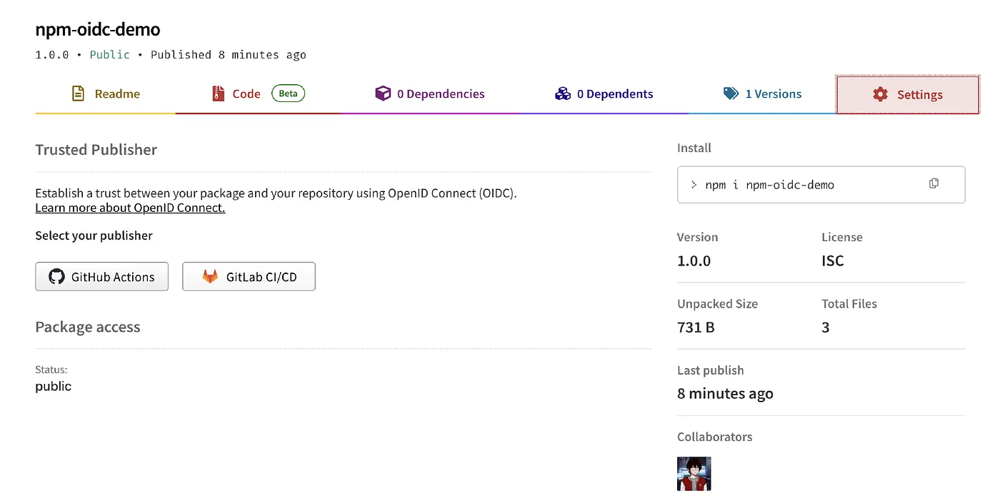
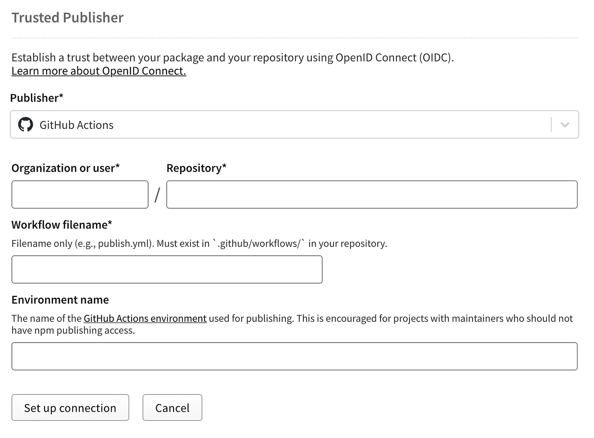
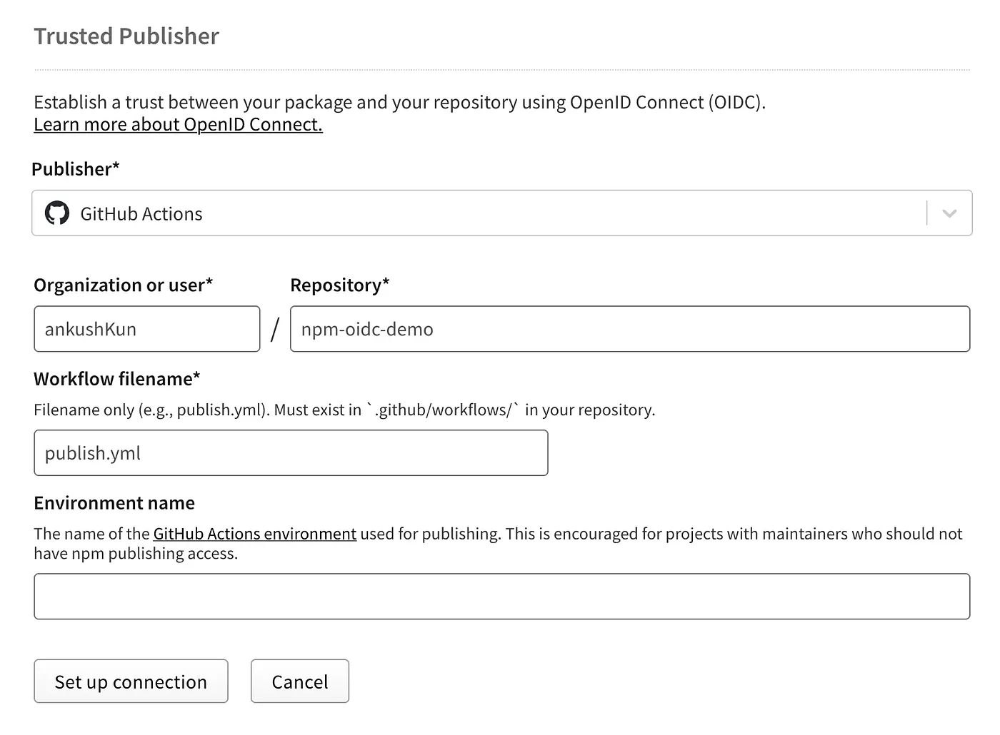
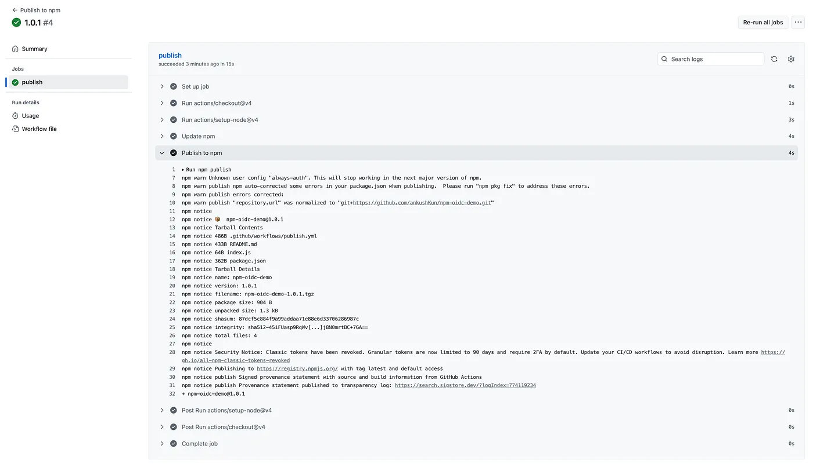
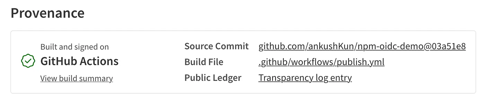

I regularly ship developer tools and publish Node packages on npm. In late 2025 npm revoked every classic access token, capped granular tokens at 90 days, and switched 2FA on by default for publishing. The full breakdown is in [this GitHub announcement](https://github.blog/changelog/2025-12-09-npm-classic-tokens-revoked-session-based-auth-and-cli-token-management-now-available/). The practical impact for anyone publishing from CI: the long-lived token you pasted into a GitHub secret years ago is dead, and its replacement expires every few weeks.

The way out is **trusted publishing**. npm uses **[OpenID Connect](https://openid.net/developers/how-connect-works/) (OIDC)** to verify that a publish request genuinely comes from a specific GitHub Actions workflow in a specific repository. No API key, no access token, nothing to rotate, and every release gets a provenance attestation for free.

This is the setup I use for my own packages. It takes three steps.

## What is npm trusted publishing?

Trusted publishing lets CI publish an npm package without storing any npm token. GitHub Actions mints a short-lived OIDC token for each job; npm checks that token against the repository and workflow filename registered on the package's settings page. If they match, `npm publish` succeeds and attaches a [provenance](https://docs.npmjs.com/generating-provenance-statements) statement linking the release to the exact commit and workflow run that built it.

It has been generally available for GitHub Actions and GitLab CI since July 2025. The requirements:

- npm CLI **11.5.1 or newer** (Node 22 is the easiest way there)
- A GitHub-hosted runner (self-hosted runners are not supported)
- `id-token: write` permission on the job
- A package that already exists on npmjs.com (more on that below)

## Step 1: Publish the package once (or skip if it already exists)

As a minimal example, here's a fresh package that logs "Hello World" to the console.

> **Note:** This package is only a demo for this guide. You don't need a throwaway package — just configure OIDC directly on your existing packages.

```bash
mkdir npm-oidc-demo && cd npm-oidc-demo
npm init -y
touch index.js
```

**index.js:**

```javascript
export function helloWorld() {
  console.log("Hello World");
}
```

**package.json:**

```json
{
  "name": "npm-oidc-demo",
  "version": "1.0.1",
  "description": "A simple hello world package",
  "main": "index.js",
  "type": "module",
  "exports": {
    ".": "./index.js"
  },
  "repository": {
    "type": "git",
    "url": "https://github.com/ankushKun/npm-oidc-demo"
  },
  "keywords": ["npm", "oidc"],
  "author": "",
  "license": "ISC"
}
```

> **Note:** A package must already exist on npmjs.com before you can attach a trusted publisher to it.

Run `npm login` to authenticate locally, verify with `npm whoami`, and publish version `1.0.0` manually once (changing the package name if you're testing with your own demo, since `npm-oidc-demo` is already taken):

```bash
$ npm whoami
ankushkun

$ npm publish
npm notice
npm notice 📦  npm-oidc-demo@1.0.0
...
+ npm-oidc-demo@1.0.0
```

The package is now live at [`npmjs.com/package/npm-oidc-demo`](https://www.npmjs.com/package/npm-oidc-demo).

## Step 2: Configure the trusted publisher on npm and GitHub Actions

Open the **Settings** tab on your package page on npmjs.com and select **GitHub Actions** as the trusted publisher.





In your repository (e.g. [`ankushKun/npm-oidc-demo`](https://github.com/ankushKun/npm-oidc-demo)), add `.github/workflows/publish.yml`:

```yaml
name: Publish to npm

on:
  release:
    types: [published]
  workflow_dispatch:

jobs:
  publish:
    runs-on: ubuntu-latest
    permissions:
      contents: read
      id-token: write
    steps:
      - uses: actions/checkout@v4

      - uses: actions/setup-node@v4
        with:
          node-version: "22.x"
          registry-url: "https://registry.npmjs.org"

      - name: Update npm
        run: npm install -g npm@latest

      - name: Publish to npm
        run: npm publish
```

Push the workflow file and fill in the repository and exact workflow filename (`publish.yml`) on npm's settings page. Leave the environment field blank unless your workflow uses a GitHub Actions environment.

Notice what is *not* in that workflow: no `NPM_TOKEN` secret, no `NODE_AUTH_TOKEN`, and no `--provenance` flag. Provenance is generated automatically over OIDC.



Save the settings. From here on, cutting a GitHub release triggers the workflow and publishes to npm with provenance automatically.

## Step 3: Cut a GitHub release

Create a new release in your GitHub repository and watch the run in the **Actions** tab.



Once it finishes, the new version appears on npmjs.com with a verified provenance badge tying the build directly back to your repository and commit.



## Gotchas the docs skip

These are the things that cost me — or people who emailed me — an afternoon each:

- **A leftover token wins over OIDC.** If `NPM_TOKEN` or `NODE_AUTH_TOKEN` is set in the job's environment, the npm CLI uses it and never tries OIDC. Delete the secret from the repository and remove any `env:` lines that reference it.
- **Old npm, old error.** On an npm CLI below 11.5.1 you get a plain `ENEEDAUTH` as if nothing was configured. The `npm install -g npm@latest` step in the workflow is not optional.
- **The first publish is a chicken-and-egg problem.** The trusted publisher setting lives on the package's page, so the package has to exist first. Publish once from your machine, then hand over to CI.
- **Unused configurations expire.** Since October 2026 a trusted publisher that has not completed a successful publish within 48 hours of being created is removed. Create the config and cut a release the same day.
- **Reusable workflows.** With `workflow_call`, register the *caller* workflow (the one that runs on `release`), not the shared one it calls.
- **Configurations cannot be edited.** To change the repo, workflow, or environment, delete the trusted publisher and add a new one. A package can have at most ten.
- **Yarn v1 says "Not found".** That is an authentication error in disguise. Publish with the npm CLI in the workflow even if the project uses Yarn for everything else.
- **Private dependencies still need a read token.** OIDC covers publishing only. If `npm ci` has to pull private packages, give it a read-only granular token with the shortest expiry you can live with.

## Timeline of the npm token changes

Searchers keep landing here asking when classic tokens actually stopped working, so here is the sequence, newest first:

| Date | Change |
| --- | --- |
| Oct 2, 2026 | Unvalidated trusted publishing configurations expire 48 hours after creation |
| Sep 30, 2026 | Opt-in dist-tag permissions for trusted publishing (npm 11.21 / 12.2 or newer) |
| Dec 9, 2025 | All classic tokens permanently revoked. `npm login` now issues 2-hour session tokens. 2FA on by default for new packages |
| Nov 5, 2025 | Creating new classic tokens disabled. New granular write tokens require 2FA by default. Existing granular write tokens capped at 90 days |
| Jul 31, 2025 | Trusted publishing with OIDC generally available for GitHub Actions and GitLab CI |

The driver behind the late-2025 changes was the [Shai-Hulud supply-chain worm](https://github.blog/security/supply-chain-security/our-plan-for-a-more-secure-npm-supply-chain/), which spread through stolen long-lived npm tokens. Trusted publishing closes that door because there is no long-lived token to steal.

## Summary

Publish once by hand, register the GitHub Actions workflow as a trusted publisher on npmjs.com, give the job `id-token: write`, and keep npm current. From then on a GitHub release publishes with provenance and nothing to rotate. The demo repository is at [`ankushKun/npm-oidc-demo`](https://github.com/ankushKun/npm-oidc-demo) if you want a copy-paste starting point.
