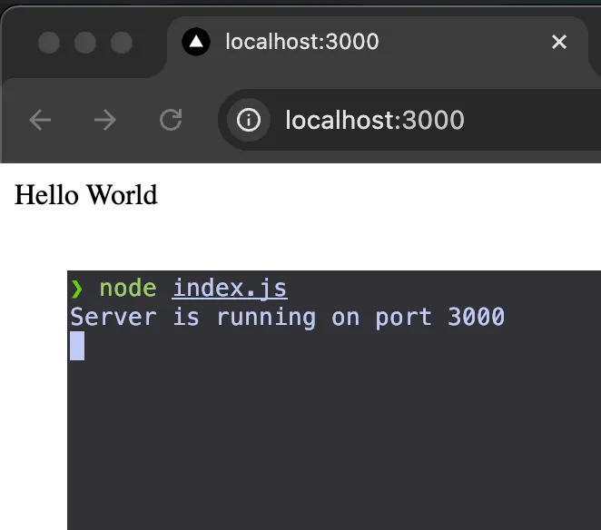
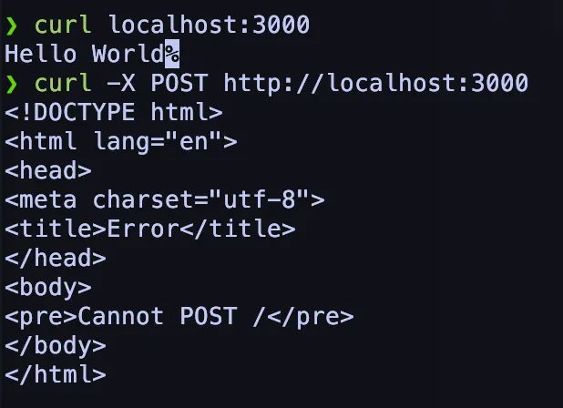
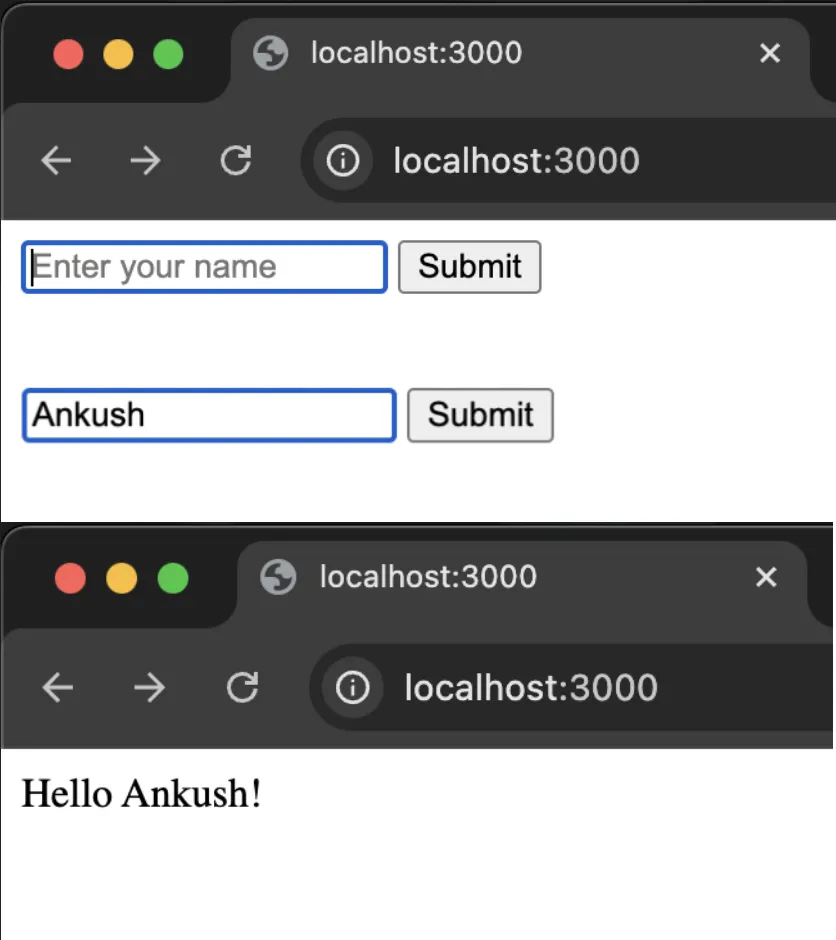
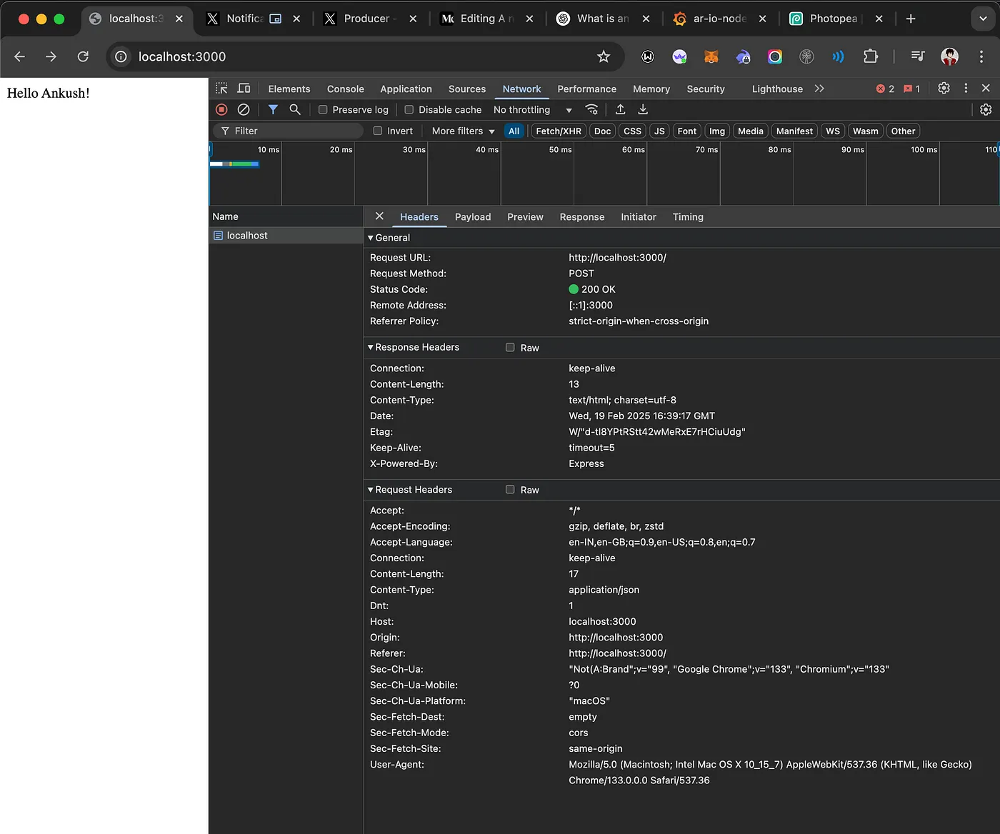

Alright, let's do this one more time — here's a straightforward walkthrough of what web APIs actually are, how they connect a frontend to a backend, and how to write your first working API in Node.js with Express.

An **API** (Application Programming Interface) defines how two pieces of software talk to each other and exchange data through structured requests and responses.

## Common API types

1. **Web APIs** — HTTP endpoints connecting clients and servers (what we're building here)
2. **OS APIs** — interfaces exposed by an operating system like Windows, macOS, or Android
3. **Library APIs** — functions and types exposed by a package (for example, a Python or npm library)
4. **Hardware APIs** — low-level drivers and embedded libraries for talking to sensors and peripherals

## RESTful Web APIs

A RESTful Web API follows **REST** (Representational State Transfer) conventions — stateless HTTP requests where URLs represent resources and HTTP methods describe the action.

### Common HTTP methods

Most REST APIs revolve around four methods:

1. **GET** — read data from the server
2. **POST** — send data to the server (usually to create something or trigger an action)
3. **PUT** — update existing data on the server
4. **DELETE** — remove data from the server

Every time you open a web page in a browser, your browser sends a `GET` request to fetch the HTML, CSS, and assets.

### HTTP status codes

Every HTTP response comes back with a numeric **status code** describing what happened:

- **1xx**: Informational responses
- **2xx**: Success (e.g., `200 OK`, `201 Created`)
- **3xx**: Redirects (e.g., `301 Moved Permanently`)
- **4xx**: Client errors (e.g., `400 Bad Request`, `401 Unauthorized`, `404 Not Found`)
- **5xx**: Server errors (e.g., `500 Internal Server Error`)

## Writing your first GET endpoint

Make sure you have Node.js and npm installed, then scaffold a minimal Express project:

```bash
mkdir api-test
cd api-test
npm init -y
npm i express
touch index.js
```

Add a basic `GET` handler to `index.js`:

```javascript
const express = require('express');
const app = express();

app.get('/', (req, res) => {
  res.send('Hello World');
});

app.listen(3000, () => {
  console.log('Server is running on port 3000');
});
```

This starts an Express server that responds to `GET /` with `"Hello World"`. Run it with:

```bash
node index.js
```

Open `http://localhost:3000/` in your browser and you should see `Hello World`.



Try changing `res.send('Hello World')` to simple HTML like `res.send('<h1>Hi there</h1>')`, restart the server (`Ctrl+C` and `node index.js`), and refresh the page to see the browser render it.

## Adding a POST endpoint

Right now our server only handles `GET /`. Sending a `POST` request to the same URL returns a 404 error:



Let's add JSON body parsing and a `POST /` route right after initializing `app`:

```javascript
app.use(express.json());

app.post('/', (req, res) => {
  const name = req.body.name;
  res.send(`Hello ${name}!`);
});
```

Restart the server and send a `POST` request using Thunder Client, Postman, or `curl`:

```bash
curl http://localhost:3000/ -d '{ "name": "Ankush" }' -H "Content-Type: application/json"
```

The server responds with:

```text
Hello Ankush!
```

That's already the core of most web APIs — structured `GET` and `POST` handlers exchanging JSON.

## Wiring up a tiny frontend

Now let's serve a small HTML page from `GET /` that sends a `fetch` `POST` request to the backend when you click Submit:

```javascript
app.get('/', (req, res) => {
  res.send(`
    <html>
      <body>
        <input type="text" id="name" name="name" placeholder="Enter your name">
        <button onclick="handleSubmit()">Submit</button>
        <script>
          async function handleSubmit() {
            const name = document.getElementById('name').value;
            const response = await fetch('/', {
              method: 'POST',
              headers: {
                'Content-Type': 'application/json'
              },
              body: JSON.stringify({ name })
            });
            const data = await response.text();
            document.body.innerHTML = data;
          }
        </script>
      </body>
    </html>
  `);
});
```

Restart Express, refresh `http://localhost:3000/`, type your name, and submit.



If you open DevTools and look at the **Network** tab, you can inspect the `POST` request, its JSON payload, the status code, and the response coming back from your server.



That's the whole loop from browser to server and back — once you're comfortable with `GET`, `POST`, JSON bodies, and status codes, the rest of backend web development builds straight on top of these primitives.
