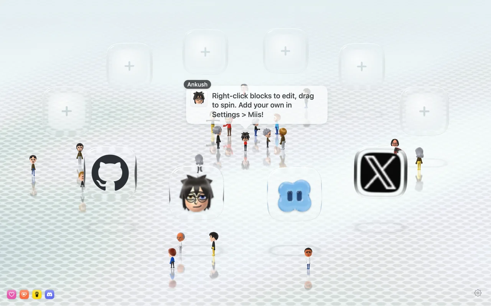
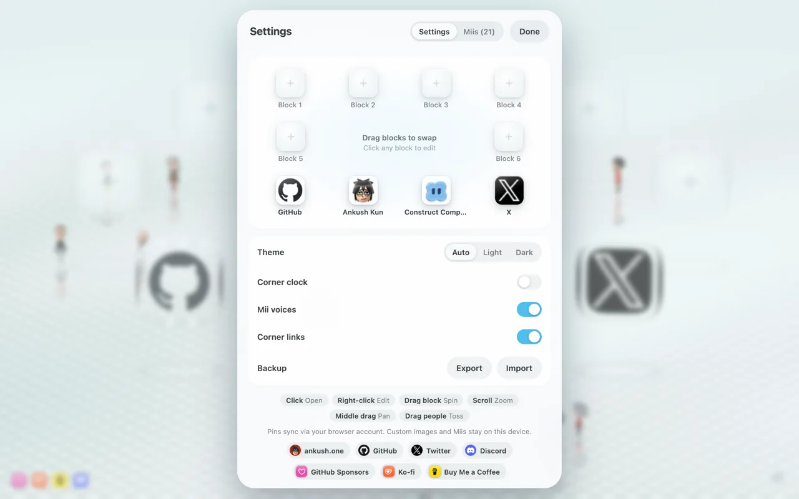

**Every new tab becomes the Wii U's plaza, with your sites around the edge and Miis hanging out in the middle.**

The home page of this site is a 3D Mii plaza modelled on the Wii U's. I wanted to see it more often than when I opened my own site, and a new tab is the page I open more than any other, so that's where it went.

Ten glass blocks float around the plaza and each one holds a site you pin. It takes the site's own icon and colour, or a picture or GIF you choose. Click a block to dive into the site, right-click it to edit it, or drag it to give it a spin. Miis wander around between them, chatting in little voices, and you can pick them up and throw them.

## Features
- Up to ten pinned sites, each with its own icon and colour, or a custom picture or animated GIF
- Your own Miis, added by dropping in a picture of a Mii QR code from a 3DS or Wii U
- Light, dark or automatic theme, and an optional clock in the corner
- Reorder the blocks in Settings, and export or import them as a backup
- No account, no ads and no tracking. Pins sync through your browser's own account

## Keeping a new tab fast
A new tab has to open instantly, which a full 3D scene doesn't do on its own. The extension runs the same plaza and character engine as this site, minus the opening, the sounds, the speech bubbles and the DJ, and with 40 Miis instead of 110 (24 on a weak device). Settings and the Mii manager only load when you open them. After five minutes without input the plaza stops drawing, and a tab left in the background for three minutes gives its graphics memory back. That last part matters more than it sounds, because Chrome runs every page of an extension in one process with a limit of 16 WebGL contexts, so a dozen open new tabs would otherwise start losing their plazas.

## Announcements
When I have something to share, like a launch or a new post, my Mii says it as a bubble on the plaza. The extension checks for one at most every six hours, without cookies or anything about you, and each one shows once.

## Stack
TypeScript on [WXT](https://wxt.dev/), building one codebase for Chrome and Firefox. The plaza is Three.js, and the Miis are drawn with [FFL.js](https://github.com/ariankordi/FFL.js), the Mii renderer in WebAssembly. Because FFL.js is AGPL, so is the extension, and every release on GitHub ships the store builds and the source archive.

New Tab Mii Plaza is a fan project, not affiliated with or endorsed by Nintendo. Mii, Wii U and Nintendo 3DS are trademarks of Nintendo.
